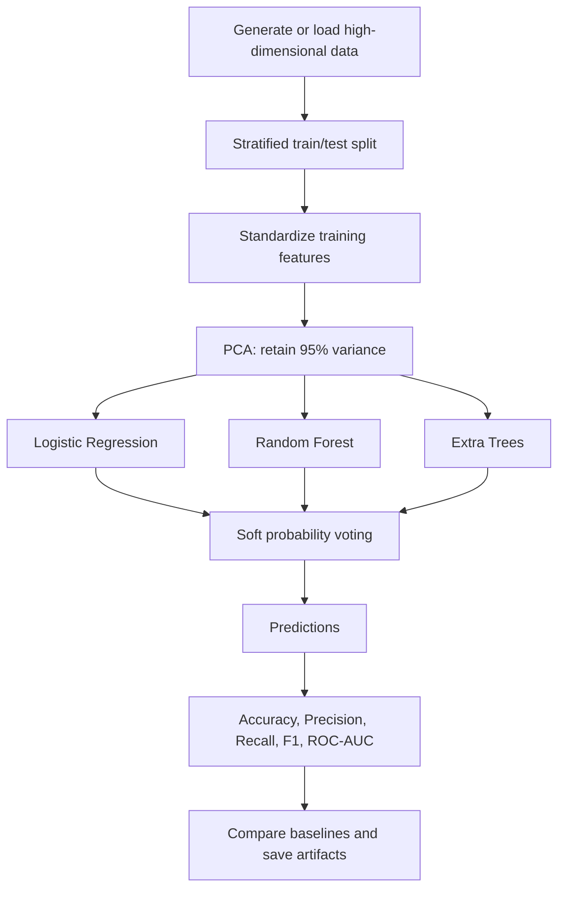

# Workflow

## Experiment design
- Fixed random seed: 42.
- Dataset: 1,800 observations × 500 features.
- Split: 80% train / 20% test, stratified.
- PCA: retain at least 95% of training-set variance.
- Validation: 5-fold stratified cross-validation on training data.
- Test set: held out until final evaluation.
